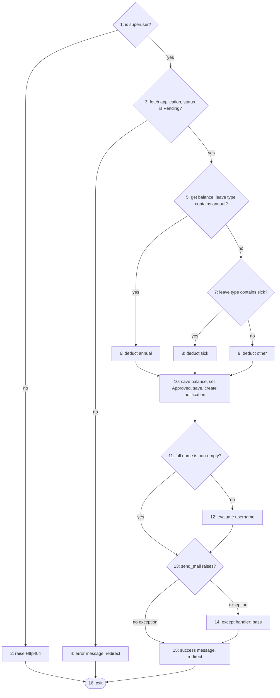

# Cyclomatic Complexity: admin_approve_leave

Function: `admin_approve_leave(request, leave_id)` in users/views.py (baseline commit e64e3bc).
Why this function: it implements the approval business rules (BR3 state check, BR1 deduction by leave type) and sends the notification and email.

## Decision points in the code
| # | Code | Decision |
|---|------|----------|
| D1 | `if not request.user.is_superuser` | admin or not |
| D2 | `if leave_application.status != 'Pending'` | Pending or already processed |
| D3 | `if 'annual' in leave_type_name` | annual leave or not |
| D4 | `elif 'sick' in leave_type_name` | sick leave or other |
| D5 | `get_full_name() or username` (inside the email text) | short-circuit `or`: second operand is evaluated only if the first is empty |
| D6 | `try: send_mail(...) except Exception` | normal flow or exception handler |

## Control-flow graph

## Calculation
Nodes N = 16. Edges E = 21.

Edges by node: 1 has 2, 2 has 1, 3 has 2, 4 has 1, 5 has 2, 6 has 1, 7 has 2, 8 has 1, 9 has 1, 10 has 1, 11 has 2, 12 has 1, 13 has 2, 14 has 1, 15 has 1 = 21.

Formula 1: V(G) = E - N + 2 = 21 - 16 + 2 = **7**.
Formula 2: V(G) = P + 1, where P = decision nodes with two outgoing edges (nodes 1, 3, 5, 7, 11, 13) = 6, so V(G) = **7**.
Both formulas agree. V(G) = 7 means 7 linearly independent paths, so at least 7 test cases are needed to cover every path in this function.

## Basis paths (7)
| Path | Route | Covered by test |
|------|-------|-----------------|
| P1 | 1(no) 2 | test_employee_cannot_approve |
| P2 | 1(yes) 3(no) 4 | test_second_approval_does_not_deduct_again |
| P3 | 1,3,5(yes) 6 10 11(yes) 13(no exception) 15 | test_approve_sets_status_and_deducts_duration |
| P4 | ...5(no) 7(yes) 8 ... | test_approval_deducts_from_matching_balance[Sick Leave] |
| P5 | ...5(no) 7(no) 9 ... | test_approval_deducts_from_matching_balance[Other Leave] |
| P6 | ...11(no) 12 13 ... | needs a user with an empty full name: test_approve_sets_status_and_deducts_duration (emp1 has no first or last name) |
| P7 | ...13(exception) 14 15 | test_approval_survives_email_failure |

## Comparison with SonarQube
| Source | Value | Note |
|--------|-------|------|
| Hand calculation (CFG) | 7 | this document |
| SonarQube cyclomatic complexity for this function | (fill in after the Sonar run) | |
| Explanation of any difference | (fill in) | SonarQube counts constructs such as if, elif, for, while, except, and/or, and ternary expressions; our graph models the same constructs, so a difference would come from a counting rule, not from the code. |